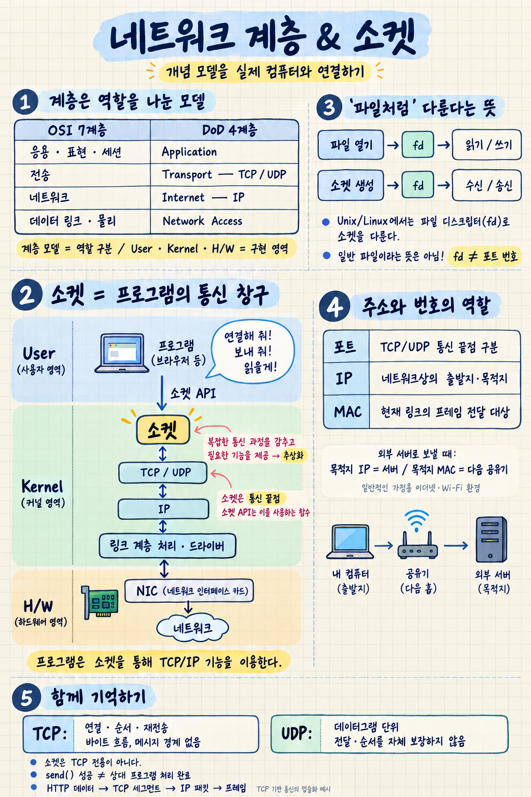

# 네트워크 계층과 소켓 — 강의 노트

## 1. 강의의 핵심

**OSI 7계층의 개념을 이해하고, 실제 컴퓨터에서 무엇이 그 역할을 수행하는지 연결해서 알아야 한다.**

OSI 7계층과 DoD 4계층은 네트워크 통신을 역할에 따라 나눈 **개념적인 모델**이다. 실제 통신은 애플리케이션 프로세스, 운영체제의 TCP/IP 스택, 드라이버, NIC 등이 수행한다.

## 2. OSI 7계층과 DoD 4계층

| OSI 7계층 | DoD(TCP/IP) 4계층 | 주요 역할 및 예시 |
|---|---|---|
| 7. 응용 계층 | Application | HTTP 등 애플리케이션 통신 규칙 |
| 6. 표현 계층 | Application | 데이터 표현, 인코딩, 암호화 등 |
| 5. 세션 계층 | Application | 대화·세션 관리 |
| 4. 전송 계층 | Transport | TCP, UDP를 이용한 전송 |
| 3. 네트워크 계층 | Internet | IP 주소와 라우팅을 통한 패킷 전달 |
| 2. 데이터 링크 계층 | Network Access | 같은 링크에서 프레임 전달 |
| 1. 물리 계층 | Network Access | 전기·빛·전파 등의 신호로 비트 전송 |

DoD 4계층에서는 OSI의 여러 계층을 묶어 설명한다. 이 대응은 역할을 이해하기 위한 것이며, 모든 구현이 정확히 이 구분대로 나뉘는 것은 아니다.

## 3. 실제 컴퓨터의 구성

컴퓨터는 실행 영역을 기준으로 다음과 같이 구분할 수 있다.

- **사용자 영역(User)**: 브라우저, 웹 서버 같은 애플리케이션이 실행되는 영역
- **커널 영역(Kernel)**: 운영체제가 자원과 장치를 관리하고 통신 기능 등을 제공하는 영역
- **하드웨어(H/W)**: CPU, 메모리, NIC 같은 물리적 장치

사용자 영역과 커널 영역에서 실행되는 코드는 소프트웨어이다.

일반적인 네트워크 통신 구조는 다음과 같다.

```text
[사용자 영역]
애플리케이션 프로세스
예: 브라우저, 웹 서버 / HTTP 처리
          ↕
     소켓 API 사용
          ↕
[커널 영역]
소켓과 TCP / UDP 처리
          ↕
         IP
          ↕
링크 계층 처리와 네트워크 드라이버
          ↕
[하드웨어]
NIC — 네트워크 인터페이스 카드
          ↕
       네트워크
```

**OSI 계층은 ‘어떤 역할을 하는가’를 구분하고, User / Kernel / H/W는 ‘어디에 구현되어 동작하는가’를 구분한다.** 따라서 두 구분이 정확히 일대일로 대응하지는 않는다.

## 4. 소켓이란?

### 쉬운 정의

**소켓은 프로그램이 운영체제의 네트워크 기능을 이용해 데이터를 보내고 받는 통신 창구이다.**

프로그램은 일반적으로 TCP/IP의 복잡한 동작을 직접 구현하지 않는다. 대신 소켓을 통해 운영체제에 요청한다.

> “이 서버에 연결해 줘.”  
> “이 데이터를 보내 줘.”  
> “받은 데이터를 읽을게.”

운영체제는 요청을 받아 실제 통신을 처리한다.

```text
프로그램 → 소켓을 통해 요청 → 운영체제의 TCP/IP가 처리
```

### “TCP/IP를 추상화했다”는 의미

**추상화란 복잡한 내부 과정을 감추고, 필요한 기능을 쉽게 사용할 수 있도록 제공하는 것이다.**

예를 들어 TCP에는 전송 순서 관리, 손실된 데이터의 재전송 등 복잡한 기능이 있다. 프로그램은 이런 과정을 일일이 처리하지 않고 소켓을 이용해 데이터를 주고받는다.

따라서 강의 맥락에서는 다음과 같이 이해할 수 있다.

> **소켓은 프로그램이 TCP/IP 통신 기능을 쉽게 이용할 수 있도록 제공되는 추상화이다.**

정확히는 **소켓은 통신 끝점이고, 소켓 API는 그것을 만들고 사용하는 함수들**이다. 소켓 자체가 TCP/IP는 아니며, TCP/IP 이외의 통신에도 소켓이 사용될 수 있다.

### “파일로 추상화했다”는 의미

Unix/Linux에서는 소켓을 **파일 디스크립터(fd)**라는 번호로 다룬다. 파일을 열었을 때도 같은 종류의 번호를 받는다.

```text
일반 파일을 열기 → fd를 받음 → 읽기 / 쓰기
소켓을 생성하기 → fd를 받음 → 수신 / 송신
```

즉, 소켓이 디스크에 저장된 일반 파일이라는 뜻이 아니다.

> **파일을 읽고 쓰는 것과 비슷한 인터페이스로 네트워크 통신을 사용할 수 있다는 뜻이다.**

여기서 파일 디스크립터와 포트 번호는 다르다.

| 구분 | 의미 |
|---|---|
| 파일 디스크립터 | 프로세스가 열린 파일이나 소켓 등의 자원을 가리킬 때 사용하는 번호 |
| 포트 번호 | TCP/UDP에서 통신 끝점을 구분하는 데 사용하는 번호 |

## 5. TCP 소켓을 사용하는 기본 흐름

클라이언트는 일반적으로 다음 순서로 통신한다.

```text
socket()  → 소켓 생성
connect() → 서버의 IP 주소와 포트로 연결 요청
send()    → 데이터 송신
recv()    → 데이터 수신
close()   → 소켓 사용 종료
```

서버는 소켓을 만들고 주소·포트를 연결한 뒤, 연결 요청을 기다린다.

```text
socket() → bind() → listen() → accept()
                                  ↓
                         연결된 소켓으로 송수신
```

서버의 **연결을 기다리는 소켓**과 **개별 클라이언트와 통신하는 소켓**은 구분된다. `accept()`는 수락한 연결을 위한 새 소켓을 반환한다.

## 6. 각 계층에서 사용하는 식별자

| 계층 | 식별자 | 역할 |
|---|---|---|
| 전송 계층 | 포트 번호 | TCP/UDP 통신 끝점 구분 |
| 인터넷·네트워크 계층 | IP 주소 | IP 네트워크에서 출발지와 목적지 지정 |
| 네트워크 접근 계층 | MAC 주소 | 이더넷·Wi-Fi 같은 링크에서 프레임 전달 대상 지정 |

입문 단계에서는 다음과 같이 기억하면 된다.

> **IP로 목적지를 지정하고, 포트로 통신할 서비스를 구분하며, MAC으로 현재 링크에서 전달한다.**

### 포트 번호 관련 보충

포트 번호는 프로세스 ID가 아니다. 하나의 프로세스가 여러 소켓과 포트를 사용할 수도 있다.

또한 서버는 같은 포트에서 여러 클라이언트의 연결을 처리할 수 있다. TCP 연결은 보통 다음 조합으로 구분한다.

```text
출발지 IP + 출발지 포트 + 목적지 IP + 목적지 포트
```

TCP와 UDP의 포트 공간도 서로 구분된다.

### MAC 주소 관련 보충

외부 서버로 데이터를 보낼 때, 내 컴퓨터가 그 서버의 MAC 주소로 직접 프레임을 보내는 것은 아니다.

일반적인 가정용 네트워크에서는 다음과 같이 시작한다.

```text
목적지 IP  : 최종 목적지인 웹 서버의 IP
목적지 MAC : 다음에 전달받을 공유기 인터페이스의 MAC
```

라우터는 패킷을 다음 링크로 전달할 때 그 링크에 맞는 새로운 프레임으로 감싼다. 따라서 MAC 주소는 인터넷 전체에서 최종 목적지를 찾는 주소로 이해하면 안 된다.

## 7. 실제 데이터 전송: 캡슐화

TCP를 사용하는 HTTP 통신을 단순화하면 다음과 같다.

```text
HTTP 데이터 생성
      ↓
TCP 헤더 추가 → TCP 세그먼트
      ↓
IP 헤더 추가 → IP 패킷
      ↓
이더넷 등의 헤더·트레일러 추가 → 프레임
      ↓
NIC를 통해 신호로 전송
```

이처럼 각 계층이 필요한 제어 정보를 덧붙이는 것을 **캡슐화**라고 한다. 받는 쪽은 반대 방향으로 각 계층의 정보를 해석하고 처리하여 애플리케이션에 데이터를 전달한다.

이 그림은 개념적인 흐름이다. 실제로는 데이터가 나뉘거나 합쳐질 수 있어, HTTP 요청 하나가 항상 패킷 하나가 되는 것은 아니다.

## 8. 추가로 알아 두면 좋은 점

### TCP와 UDP는 다르다

| TCP | UDP |
|---|---|
| 연결을 설정하고 통신 | TCP 방식의 연결 설정 없이 통신 가능 |
| 순서가 있는 바이트 흐름 제공 | 데이터그램 단위로 전달 |
| 손실에 대한 재전송 등 제공 | 전달·순서·재전송을 자체 보장하지 않음 |
| 메시지 경계를 보존하지 않음 | 데이터그램 경계 보존 |

TCP에서 프로그램이 두 번 보냈다고 해서 상대도 반드시 두 번에 나누어 읽는 것은 아니다. 따라서 응용 계층에서 메시지를 구분하는 규칙이 필요하다.

### 송신 성공과 상대의 처리 완료는 다르다

`send()`가 성공했다는 것은 일반적으로 운영체제가 송신할 데이터를 받아들였다는 의미이다. 상대 프로그램이 데이터를 읽고 처리를 완료했다는 뜻은 아니다.

### HTTP가 항상 TCP를 사용하는 것은 아니다

HTTP/1.1과 HTTP/2는 일반적으로 TCP를 사용한다. HTTP/3는 UDP 위에서 동작하는 QUIC을 사용한다.

따라서 판서의 **“HTTP → TCP → IP”는 대표적인 통신 구조를 설명한 것**으로 이해하면 된다.

## 핵심 기억 문장

> **프로그램은 소켓을 통해 운영체제의 통신 기능을 사용한다. 운영체제의 TCP/IP 스택, 드라이버, NIC가 실제 전송을 처리한다. OSI와 DoD 모델은 이 과정의 역할을 계층으로 나누어 설명하는 틀이다.**

