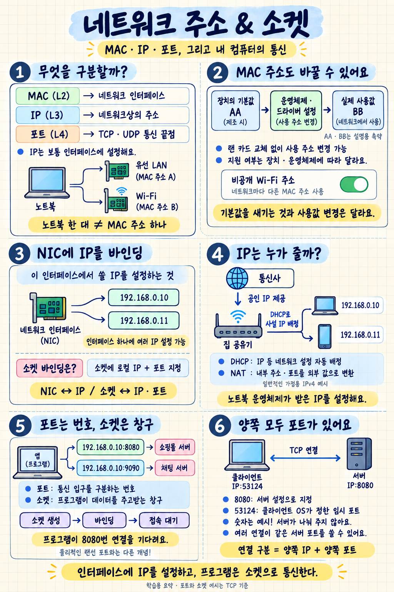

# 네트워크 기초 정리: MAC 주소부터 IP 할당까지

> 첨부 판서와 이후 질의응답을 바탕으로 작성한 학습 노트입니다. 영상 자막은 확보하지 못했으므로 영상 전체를 직접 확인한 요약은 아닙니다. 포트·소켓 예시는 TCP, 가정의 IP 할당 예시는 일반적인 IPv4 환경을 기준으로 합니다.
>
> 원본 수업: [MAC 주소, IP 주소, Port 번호가 식별하는 것](https://www.youtube.com/watch?v=JDh_lzHO_CA)

## 1. 수업의 중심: 무엇을 식별하는가?

| 구분 | 계층 | 식별 대상 | 이해를 위한 질문 |
|---|---|---|---|
| MAC 주소 | 2계층: 데이터 링크 | 네트워크 인터페이스(NIC) | 어느 네트워크 인터페이스인가? |
| IP 주소 | 3계층: 네트워크 | 호스트를 식별하는 주소. 실제로는 보통 인터페이스에 설정 | 네트워크상의 어디로 보낼까? |
| 포트 번호 | 4계층: 전송 | TCP·UDP의 통신 종단점을 구분하는 번호 | 도착한 통신을 어느 소켓으로 전달할까? |

판서에서는 **MAC → NIC / IP → 호스트 / Port → 프로세스·서비스**로 설명한다. 처음에는 이렇게 기억하고, 포트가 프로세스 ID 자체는 아니라는 점을 함께 이해하면 된다.

## 2. NIC: 노트북 한 대에 랜 카드가 여러 개 있을 수 있다

NIC는 Network Interface Card의 약자로, 흔히 랜 카드라고 부른다. 네트워크에 연결하는 인터페이스를 제공한다.

- **유선 LAN 어댑터:** 랜선을 통해 연결한다.
- **무선 LAN 어댑터:** Wi-Fi로 연결한다.
- **USB LAN 어댑터·도크:** 유선 인터페이스가 없는 노트북에도 추가할 수 있다.

```text
내 노트북
├─ Wi-Fi 인터페이스 → 무선으로 공유기에 연결
└─ 유선 인터페이스 → 랜선으로 공유기에 연결
```

‘카드’라는 이름과 달리 메인보드에 통합된 부품일 수도 있다. 모든 노트북에 유선·무선 인터페이스가 둘 다 내장되어 있는 것은 아니다.

각 인터페이스는 보통 각자의 MAC 주소를 가진다. 따라서 **컴퓨터 한 대 = MAC 주소 하나**는 아니다.

## 3. MAC 주소는 실물 랜 카드를 교체하지 않아도 변경할 수 있다

### 기본 주소와 실제 사용하는 주소

| 구분 | 의미 |
|---|---|
| 제조사가 부여한 기본 MAC 주소 | 장치에 기본적으로 부여된 주소 |
| 통신에 사용하는 MAC 주소 | 기본 주소를 사용하거나, 운영체제·드라이버가 지원하면 별도로 설정한 주소를 사용 |

설명을 위해 주소를 AA, BB로 줄이면 다음과 같다.

```text
기본 상태
장치의 기본 주소: AA → 통신에 사용하는 주소: AA

다른 주소를 사용하도록 설정한 상태
장치의 기본 주소: AA → 통신에 사용하는 주소: BB
```

보통 말하는 ‘MAC 주소 변경’은 장치의 기본값을 다시 새기는 작업이 아니라 **실제로 사용할 주소를 다르게 설정하는 것**이다. 기본값 자체의 변경 가능성은 장치에 따라 다르므로 ‘절대 변경 불가’라고 단정하지 않는다.

### 어떻게 바꾸는가?

운영체제 설정을 바꾸면 드라이버와 장치가 다른 MAC 주소를 사용하도록 적용한다. MAC 주소는 실제 통신에서 프레임에 담기는 값이며, 상대 장치가 내 랜 카드의 기본값을 직접 읽는 것은 아니다.

대표적인 예가 Wi-Fi의 비공개 주소 기능이다.

- **지원되는 Mac:** 시스템 설정 → Wi-Fi → 해당 네트워크의 세부사항 → 비공개 Wi-Fi 주소
- **지원되는 Windows 장치:** 설정 → 네트워크 및 인터넷 → Wi-Fi → 임의 하드웨어 주소

Mac의 ‘고정’은 별도로 생성한 비공개 주소를 유지한다는 뜻이고, ‘순환’은 비공개 주소를 주기적으로 변경한다는 뜻이다. ‘끔’은 하드웨어 MAC 주소를 사용한다. 지원 여부와 메뉴는 운영체제 버전·장치에 따라 다르다. [Apple 설명](https://support.apple.com/en-ie/102509), [Microsoft 설명](https://support.microsoft.com/en-us/windows/experience/connectivity-networking/connect-to-a-wi-fi-network-in-windows)

> MAC 주소는 네트워크 인터페이스를 식별하지만, 기기에 영구히 고정된 불변의 이름표는 아니다.

## 4. IP 주소를 NIC에 바인딩한다는 뜻

이 문맥에서 바인딩은 **“이 네트워크 인터페이스가 이 IP 주소를 사용하도록 운영체제에 설정한다”**는 뜻이다. 랜 카드에 물리적으로 주소를 새기는 작업이 아니다.

하나의 인터페이스에 여러 IP 주소를 설정할 수 있다.

```text
유선 인터페이스 하나
├─ 192.168.0.10
└─ 192.168.0.11
```

운영체제는 두 주소를 모두 자기 컴퓨터에 설정된 주소로 인식한다. 네트워크가 올바르게 구성되어 있다면 다른 컴퓨터는 어느 주소로든 이 컴퓨터와 통신할 수 있다. **컴퓨터나 랜 카드가 두 개가 된 것은 아니다.**

### 실제 설정 예시

리눅스에서 인터페이스 이름이 `eth0`이고, 아래 주소가 해당 네트워크에서 사용 가능하다고 가정하면:

```bash
sudo ip address add 192.168.0.10/24 dev eth0
sudo ip address add 192.168.0.11/24 dev eth0
```

- `ip address add`: IP 주소를 추가한다.
- `dev eth0`: 추가할 인터페이스를 지정한다.
- `/24`: 네트워크 범위를 나타내는 프리픽스 길이이다.

같은 인터페이스를 지정해서 주소를 두 번 추가한 것이다. 실제 주소와 인터페이스 이름은 환경에 맞아야 하고, 다른 기기와 주소가 겹치면 안 된다. 이 명령은 실행 중인 설정에 적용되며 재부팅 후 유지하려면 별도의 영구 설정이 필요하다. [리눅스 명령어 설명](https://man7.org/linux/man-pages/man8/ip-address.8.html)

## 5. IP 주소는 누가 할당하는가?

일반적인 가정용 IPv4 네트워크에서는 두 단계를 구분한다.

```text
통신사
  │ 인터넷 쪽 주소 제공
  ▼
집 공유기
  ├─ 노트북에 사설 IP 배정: 192.168.0.10
  └─ 휴대폰에 사설 IP 배정: 192.168.0.11
```

| 구분 | 용도 | 일반적인 할당 주체 |
|---|---|---|
| 공인 IP | 인터넷에서 사용하는 주소 | 통신사가 고객의 인터넷 연결에 제공 |
| 사설 IP | 집·회사 등 내부 네트워크에서 사용하는 주소 | 공유기 등의 DHCP 서버 |

다른 집에서도 `192.168.0.10`을 사용할 수 있다. 서로 다른 내부 네트워크이기 때문이다.

### Wi-Fi에 연결하면 자동으로 벌어지는 일

1. 노트북이 네트워크에 연결한다.
2. 노트북의 DHCP 클라이언트가 사용할 IP 설정을 요청한다.
3. 공유기의 DHCP 서버가 IP 주소와 사용 기간, 게이트웨이 등의 설정을 제공한다.
4. 노트북 운영체제가 해당 IP를 Wi-Fi 인터페이스에 설정한다.

**DHCP는 IP 주소 등의 네트워크 설정을 자동으로 배정하는 방식**이다. 우리가 직접 설정한 기억이 없어도, 운영체제가 자동으로 처리하고 있었던 것이다.

필요하면 관리자가 주소를 수동으로 설정할 수도 있다. 다만 로컬 설정에 주소를 적는 것만으로 인터넷에서 사용할 공인 IP를 얻는 것은 아니다.

### NAT는 무엇인가?

집 안 기기가 인터넷에 접속할 때 공유기는 보통 **사설 IP와 포트를 공인 IP와 포트로 변환하고 연결 관계를 기록**한다. 덕분에 여러 기기가 하나의 공인 IP를 함께 사용할 수 있다.

통신사에 따라 공유기에도 사설 주소 등을 제공하고, 통신사 내부에서 공인 IP를 공유시키는 경우도 있다. 따라서 ‘집 공유기는 반드시 전용 공인 IP를 하나 받는다’고 단정하면 안 된다.

## 6. 포트 번호: 컴퓨터 안의 통신 입구 번호

포트는 **컴퓨터 안에서 네트워크 통신이 드나들 곳을 구분하는 논리적인 번호**이다.

```text
내 컴퓨터: 192.168.0.10
├─ TCP 8080 → 쇼핑몰 서버가 연결을 기다림
└─ TCP 9090 → 채팅 서버가 연결을 기다림
```

- `192.168.0.10:8080`으로 접속하면 쇼핑몰 서버에 연결된다.
- `192.168.0.10:9090`으로 접속하면 채팅 서버에 연결된다.

**8080이라는 숫자 자체가 웹 서버를 뜻하지는 않는다.** 프로그램을 그 번호에서 기다리도록 설정했기 때문에 그곳으로 접속하는 것이다.

‘8080 포트에서 서버를 실행한다’는 일상 표현의 정확한 의미는 **‘서버 프로그램이 컴퓨터에서 실행 중이고, TCP 8080번으로 오는 연결을 기다린다’**이다.

포트 번호는 TCP와 UDP에서 각각 사용한다. 같은 숫자라도 TCP 8080과 UDP 8080은 구분된다.

## 7. 왜 포트를 프로세스·서비스·인터페이스라고 설명할까?

판서의 설명은 분야별 관심사를 나누어 이해하면 쉽다.

| 관점 | 관심 대상 | 예시 |
|---|---|---|
| 프로그램 개발자 | 실행 중인 프로그램인 프로세스 | “8080을 어떤 프로그램이 사용하지?” |
| 네트워크 담당자 | 외부에 제공하는 기능인 서비스 | “8080의 웹 서비스에 접속할 수 있나?” |
| 하드웨어 담당자 | 장비의 연결 지점인 인터페이스 | “랜선을 스위치 3번 포트에 꽂자.” |

앞의 두 개는 같은 TCP·UDP 포트를 서로 다른 관심사로 설명한다. 마지막의 물리 포트는 다른 종류의 포트이다. **스위치의 3번 연결구와 TCP 8080번을 같은 번호 체계로 생각하면 안 된다.**

또한 포트는 프로세스 ID(PID)가 아니다. 하나의 프로세스가 여러 포트를 사용할 수도 있다.

## 8. 소켓: 프로그램이 실제로 통신할 때 사용하는 창구

**소켓은 프로그램이 운영체제를 통해 네트워크 데이터를 주고받는 데 사용하는 통신 종단점이다.**

- **포트:** 통신 입구를 구분하는 번호
- **소켓:** 프로그램이 데이터를 읽고 쓰는 데 사용하는 통신 창구
- **프로세스:** 소켓을 사용하는 실행 중인 프로그램

일반적인 TCP 서버는 다음 순서로 동작한다.

```text
① 소켓 생성
② 로컬 IP 주소와 포트에 바인딩
③ 연결 요청을 기다림(listen)
④ 연결을 받아들임(accept) → 연결된 소켓을 얻음
⑤ 연결된 소켓으로 요청을 읽고 응답을 보냄
```

서버 프레임워크가 이를 처리해 주므로 개발자는 포트 설정만 했을 수도 있다.

**연결을 기다리는 소켓**과 **특정 클라이언트와 데이터를 주고받는 연결된 소켓**은 구분된다. 여러 사람이 같은 8080으로 접속해도 연결마다 소켓을 통해 각각 통신할 수 있다. 따라서 **포트 하나 = 소켓 하나**는 아니다.

판서의 user mode / kernel mode 구분은 일반적인 운영체제에서 애플리케이션은 사용자 영역에서 실행되고, TCP/IP 처리는 주로 커널 영역에서 이루어진다는 구조를 보여 준다. 프로그램은 소켓 API를 통해 운영체제에 통신을 요청한다.

## 9. 접속하는 클라이언트도 자기 포트가 필요하다

TCP 통신에서는 양쪽 모두 IP 주소와 포트 번호를 사용한다.

```text
클라이언트 IP:53124  ←── TCP 연결 ──→  서버 IP:8080
```

| 포트 | 의미 | 누가 정하는가? |
|---|---|---|
| 8080 | 서버가 연결을 기다리는 포트 | 서버 설정으로 지정 |
| 53124 | 클라이언트가 이번 통신에 사용하는 임시 포트 | 보통 클라이언트 운영체제가 자동 할당 |

`53124`는 예시이며 항상 이 번호를 사용하는 것은 아니다. **서버가 클라이언트에 나눠 주는 번호가 아니다.**

연결된 TCP 소켓에는 내 쪽 주소와 상대 쪽 주소가 있다.

| 관점 | 내 쪽 주소 | 상대 쪽 주소 |
|---|---|---|
| 클라이언트 | 클라이언트 IP:53124 | 서버 IP:8080 |
| 서버 | 서버 IP:8080 | 클라이언트 IP:53124 |

서버는 TCP 연결을 양쪽 IP와 포트의 조합으로 구분할 수 있다. NAT가 중간에 있으면 서버가 보는 클라이언트 주소·포트는 변환된 값일 수 있다.

## 10. 같은 ‘바인딩’이지만 연결하는 대상이 다르다

| 표현 | 연결하는 대상 | 의미 |
|---|---|---|
| NIC에 IP를 바인딩 | 네트워크 인터페이스 ↔ IP 주소 | 이 인터페이스에서 사용할 주소를 설정 |
| 소켓을 IP·포트에 바인딩 | 소켓 ↔ 로컬 IP 주소와 포트 | 이 통신 창구가 사용할 주소와 번호를 지정 |

```text
네트워크 인터페이스
└─ IP: 192.168.0.10
   ├─ TCP 8080에 바인딩한 소켓 → 쇼핑몰 서버
   └─ TCP 9090에 바인딩한 소켓 → 채팅 서버
```

이는 관계를 이해하기 위한 그림이다. 포트나 소켓이 실제 랜 카드 안에 물리적으로 들어 있다는 뜻은 아니다.

## 11. 내 노트북의 서버를 인터넷에 공개하면?

로컬에서 서버를 실행하는 것만으로 인터넷에 자동 공개되지는 않는다. 외부에서 서버까지 도달할 경로, 서버의 수신 주소 설정, 방화벽 허용 등이 갖춰져야 한다.

가정용 공유기의 포트 전달을 사용하는 예시는 다음과 같다.

```text
외부 사용자의 브라우저
        │ 공개 IP:8080으로 접속
        ▼
집 공유기
        │ 내부 주소로 전달
        ▼
노트북의 사설 IP 192.168.0.10:8080
        │
        ▼
서버가 연결을 받아 연결된 소켓으로 요청 처리
        │
        └─ 같은 TCP 연결을 통해 응답
```

외부 포트와 내부 포트는 꼭 같을 필요는 없다. 예를 들어 공유기의 외부 8080을 내부 서버의 3000으로 전달하도록 설정할 수도 있다.

## 12. 복습 질문

**Q. 컴퓨터 한 대의 MAC 주소는 반드시 하나인가?**  
A. 아니다. 여러 인터페이스가 있을 수 있고, 각 인터페이스는 보통 자기 MAC 주소를 가진다.

**Q. MAC 주소를 바꾸려면 랜 카드를 교체해야 하나?**  
A. 아니다. 지원되는 환경에서는 소프트웨어 설정으로 실제 통신에 사용하는 주소를 바꿀 수 있다.

**Q. NIC 하나에는 IP 하나만 설정할 수 있나?**  
A. 아니다. 여러 IP 주소를 설정할 수 있다.

**Q. 집에서 노트북의 사설 IP는 보통 누가 배정하나?**  
A. 공유기의 DHCP 서버가 배정하고, 노트북 운영체제가 인터페이스에 설정한다.

**Q. 8080은 프로그램이 실행되는 물리적 공간인가?**  
A. 아니다. 프로그램의 통신에 사용하는 논리적인 포트 번호이다.

**Q. 포트와 소켓은 같은 것인가?**  
A. 아니다. 포트는 번호이고, 소켓은 프로그램이 통신할 때 사용하는 창구이다.

**Q. 클라이언트의 임시 포트는 서버가 할당하나?**  
A. 아니다. 보통 클라이언트 자신의 운영체제가 자동으로 정한다.

**Q. 서버가 한 포트에서 여러 사람과 통신할 수 있나?**  
A. 가능하다. 연결별 소켓이 있고 양쪽 IP·포트 조합으로 연결을 구분한다.

## 핵심 문장

> **NIC는 네트워크에 연결하는 인터페이스이고, IP는 그 인터페이스에 설정하는 네트워크 주소다. 프로그램은 소켓으로 통신하며, 포트 번호는 그 통신 종단점을 구분한다. TCP 연결의 양쪽에는 각각 IP 주소와 포트 번호가 있다.**


