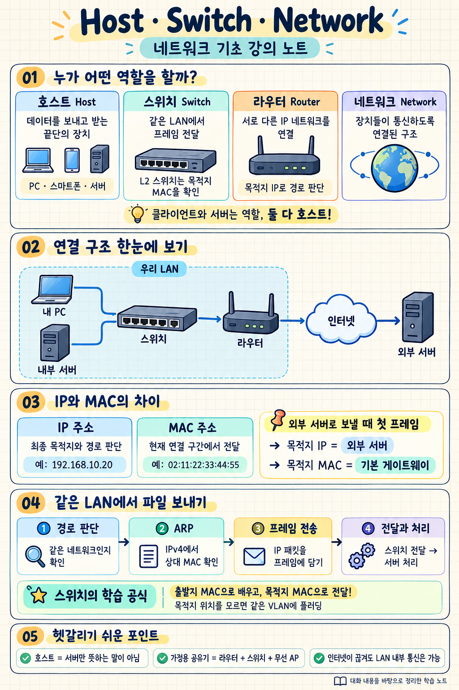

# 강의 노트: Host, Switch, Network의 관계

> 앞서 설명한 내용을 정리한 학습 노트입니다. 회원 전용 영상의 내용을 직접 요약한 것은 아닙니다.

## 1. 핵심 개념

| 개념 | 의미 | 예시 |
|---|---|---|
| **호스트(Host)** | 네트워크에서 데이터를 보내거나 받는 끝단의 장치 | PC, 스마트폰, 서버, 네트워크 프린터 |
| **스위치(Switch)** | 연결된 장치 사이에서 데이터를 전달하는 장치 | 사무실의 L2 스위치 |
| **네트워크(Network)** | 장치들이 데이터를 주고받을 수 있도록 연결된 구조 | 집 LAN, 회사 네트워크 |
| **라우터(Router)** | 서로 다른 IP 네트워크 사이에서 데이터를 전달하는 장치 | 가정용 공유기의 라우터 기능 |

```text
내 PC ──┐
        │
서버 ── 스위치 ── 라우터 ── 다른 네트워크
        │
프린터 ─┘
```

## 2. 호스트와 클라이언트·서버

**호스트**는 통신에 참여하는 장치를 뜻하고, **클라이언트와 서버**는 통신에서 맡는 역할을 뜻한다.

- **클라이언트:** 서비스를 요청하는 역할
- **서버:** 요청을 받아 서비스를 제공하는 역할
- **호스트:** 클라이언트와 서버를 모두 포함하는 개념

예를 들어 PC에서 파일 서버에 사진을 업로드한다면:

| 장치 | 역할 | 호스트 여부 |
|---|---|---|
| 내 PC | 업로드를 요청하는 클라이언트 | 호스트 |
| 파일 서버 | 파일을 받아 저장하는 서버 | 호스트 |

하나의 컴퓨터가 서비스에 따라 클라이언트와 서버 역할을 동시에 할 수도 있다.

## 3. IP 주소와 MAC 주소

| 구분 | IP 주소 | MAC 주소 |
|---|---|---|
| 예시 | `192.168.10.20` | `02:11:22:33:44:55` |
| 주된 용도 | IP 네트워크에서 목적지와 경로 판단 | 이더넷 같은 로컬 연결에서 프레임 전달 |
| 이를 보고 전달하는 대표 장치 | 라우터 | L2 스위치 |

이해를 위한 핵심 질문:

- **IP 주소:** 최종적으로 어느 목적지로 가야 하는가?
- **MAC 주소:** 현재 연결 구간에서 누구에게 전달해야 하는가?

주소는 네트워크 인터페이스에 설정된다. 따라서 한 PC도 유선과 와이파이에 각각 주소가 있을 수 있다. MAC 주소도 변경되거나 임의로 설정될 수 있다.

## 4. L2 스위치의 동작

스위치는 **MAC 주소 테이블**을 이용해 프레임을 전달한다.

| MAC 주소 | 연결된 방향 |
|---|---|
| PC A의 MAC | 포트 1 |
| PC B의 MAC | 포트 2 |
| 서버의 MAC | 포트 3 |

### 학습과 전달 과정

1. 프레임이 들어오면 **출발지 MAC 주소**를 확인한다.
2. 출발지 MAC과 들어온 포트를 연결해 기억한다.
3. **목적지 MAC 주소**를 테이블에서 찾는다.
4. 찾은 정보를 바탕으로 전달한다.

| 상황 | 동작 |
|---|---|
| 목적지 MAC의 포트를 알고 있음 | 해당 포트로 전달 |
| 목적지 MAC의 포트를 모름 | 같은 VLAN에서 수신 포트를 제외한 다른 포트들로 플러딩 |
| 브로드캐스트 프레임 | 같은 VLAN에서 수신 포트를 제외한 다른 포트들로 전달 |

**암기 포인트: 출발지 MAC으로 배우고, 목적지 MAC으로 전달한다.**

## 5. 같은 네트워크 안에서 통신하는 과정

다음과 같이 설정했다고 가정한다.

```text
내 PC IP       : 192.168.10.10
파일 서버 IP   : 192.168.10.20
서브넷 마스크  : 255.255.255.0
네트워크 범위  : 192.168.10.0/24
```

두 장치가 같은 LAN에 있고, 일반적인 통신이 가능한 설정일 때:

### ① 목적지까지의 전달 경로 판단

내 PC는 목적지 IP와 자신의 네트워크 설정 및 경로 정보를 확인한다.

이 예제에서는 서버가 같은 IP 네트워크에 있으므로 직접 전달할 수 있다.

### ② ARP로 서버의 MAC 주소 확인

서버의 MAC 주소를 모르면 **ARP 요청**을 브로드캐스트한다.

> “192.168.10.20을 사용하는 장치는 자신의 MAC 주소를 알려주세요.”

서버가 자신의 MAC 주소를 응답한다. 알아낸 정보는 잠시 저장해서 재사용한다.

※ ARP는 IPv4에서 사용하는 방식이다.

### ③ 데이터를 프레임에 담아 전송

```text
이더넷 프레임
├─ 출발지 MAC: 내 PC
├─ 목적지 MAC: 파일 서버
└─ IP 패킷
   ├─ 출발지 IP: 내 PC
   ├─ 목적지 IP: 파일 서버
   └─ 상위 계층의 데이터
```

- **패킷:** 여기서는 IP 계층의 데이터 단위
- **프레임:** 이더넷 등 데이터 링크 계층의 데이터 단위

IP 패킷을 이더넷 프레임 안에 담는 것처럼, 계층별 정보를 덧붙이는 과정을 **캡슐화**라고 한다.

### ④ 스위치가 전달하고 서버가 처리

스위치는 목적지 MAC을 보고 프레임을 전달한다. 서버는 수신한 데이터를 처리하고 파일을 저장한다.

## 6. 다른 네트워크로 통신하는 과정

```text
내 PC → 스위치 → 기본 게이트웨이 → 인터넷 → 외부 서버
```

**기본 게이트웨이**는 더 구체적인 경로가 없을 때 다른 네트워크로 보내기 위해 이용하는 라우터다.

외부 서버로 보낼 때 첫 이더넷 프레임의 주소는 다음과 같다.

| 항목 | 목적지 |
|---|---|
| **목적지 IP** | 외부 서버 |
| **목적지 MAC** | 현재 LAN의 게이트웨이 |

최종 목적지는 외부 서버지만, 현재 LAN에서 먼저 데이터를 건네줄 상대는 게이트웨이이기 때문이다.

라우터는 목적지 IP를 보고 다음 경로를 정하고, 다음 연결 구간에 맞게 패킷을 다시 포장한다.

- 이더넷의 MAC 주소는 전달 구간에 따라 달라진다.
- 출발지·목적지 IP는 일반적으로 유지되지만, NAT가 적용되면 변환될 수 있다.

## 7. LAN, 네트워크, 인터넷

| 용어 | 의미 |
|---|---|
| **LAN** | 집이나 사무실 등 비교적 가까운 범위의 로컬 네트워크 |
| **IP 네트워크** | IP 주소와 서브넷 설정으로 구분하는 논리적 네트워크 |
| **인터넷** | 수많은 네트워크가 서로 연결된 구조 |

주의할 점:

- 스위치 하나에 연결되어 있어도 VLAN이나 IP 설정에 따라 네트워크가 나뉠 수 있다.
- 스위치 여러 대가 하나의 LAN을 구성할 수도 있다.
- 인터넷 연결이 끊겨도 LAN 내부 통신은 가능할 수 있다.

예를 들어 인터넷이 끊겨도 PC와 프린터의 로컬 연결이 유지된다면 로컬 인쇄는 가능하다.

## 8. 가정용 공유기의 역할

가정용 공유기는 보통 여러 기능을 하나의 기기에 포함한다.

| 기능 | 역할 |
|---|---|
| 라우터 | 집 네트워크와 외부 네트워크 연결 |
| 유선 스위치 | 유선 장치들을 LAN에 연결 |
| 무선 AP | 와이파이 장치들을 LAN에 연결 |

따라서 **공유기라는 기기 한 대 안에서 스위치와 라우터의 역할이 함께 수행될 수 있다.**

## 9. 복습 문제

1. **내 PC와 서버 중 어느 쪽이 호스트인가?**  
   → 둘 다 호스트다.

2. **L2 스위치는 무엇을 보고 프레임을 전달하는가?**  
   → 목적지 MAC 주소.

3. **스위치는 무엇을 보고 MAC 주소 테이블을 학습하는가?**  
   → 들어온 프레임의 출발지 MAC 주소와 수신 포트.

4. **외부 서버로 보낼 때 첫 프레임의 목적지 MAC은 누구의 것인가?**  
   → 일반적인 구성에서는 기본 게이트웨이의 MAC 주소.

5. **인터넷이 끊기면 같은 LAN의 장치끼리도 통신할 수 없는가?**  
   → 아니다. 로컬 연결과 설정이 정상이라면 통신할 수 있다.

