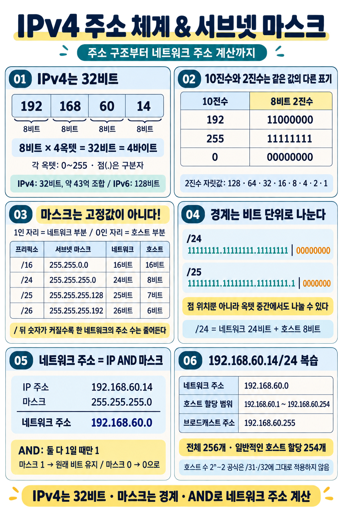

# 강의 노트: IPv4 주소 체계와 서브넷 마스크

강의 화면 내용에 방금 이야기한 **10진수 표기의 의미와 서브넷 마스크가 고정값이 아니라는 점**까지 추가한 정리야 😊

### 1. IP 주소란?

**IP는 Internet Protocol의 약자**야. IP 주소는 네트워크에서 통신 대상을 식별하고 데이터를 전달하는 데 사용해.

강의에서는 ‘호스트에 대한 식별자’라고 설명해. 정확히는 **장치의 네트워크 인터페이스에 설정하는 주소**야.

| 구분 | 주소 길이 | 가능한 주소 조합 |
|---|---:|---:|
| **IPv4** | **32비트** | \(2^{32}\)개, 약 **43억 개** |
| **IPv6** | **128비트** | \(2^{128}\)개 |

IPv4의 모든 주소를 일반 호스트의 공인 주소로 사용할 수 있는 것은 아니야. 특수 목적으로 예약된 범위도 있어.

### 2. IPv4는 8비트씩 네 부분으로 표시한다

```text
IPv4 주소: 192.168.60.14

   192    .    168    .     60    .     14
  8비트       8비트        8비트        8비트

                  총 32비트
```

- **8비트 한 묶음**을 **옥텟(Octet)**이라고 해.
- 각 옥텟은 **0~255** 사이의 값을 가져.
- 점(`.`)은 소수점이 아니라 **옥텟을 구분하는 표시**야.
- 전체 길이는 **32비트 = 4바이트**야.

8비트로 표현할 수 있는 조합은 \(2^8 = 256\)개야. **0부터 세므로 최댓값은 255**가 돼.

### 3. 10진수와 2진수는 같은 값을 다르게 적은 것이다

**10진수**는 우리가 평소 사용하는 숫자 표기이고, **2진수**는 `0`과 `1`로 수를 표현하는 방식이야.

IPv4 주소는 사람이 읽기 쉽도록 각 8비트 값을 10진수로 적어.

| 10진수 | 8비트 2진수 |
|---:|---|
| 192 | `11000000` |
| 168 | `10101000` |
| 60 | `00111100` |
| 14 | `00001110` |
| 255 | `11111111` |
| 0 | `00000000` |

따라서 아래 두 줄은 **같은 IP 주소**를 다르게 표현한 거야.

```text
10진수: 192.168.60.14

2진수:  11000000.10101000.00111100.00001110
```

**2진수 자릿값 암기**

| 왼쪽부터 | 128 | 64 | 32 | 16 | 8 | 4 | 2 | 1 |
|---|---:|---:|---:|---:|---:|---:|---:|---:|

예를 들어:

```text
192 = 128 + 64 → 11000000
 14 = 8 + 4 + 2 → 00001110
255 = 모든 자릿값의 합 → 11111111
```

### 4. IP 주소는 네트워크 부분과 호스트 부분으로 나뉜다

```text
IPv4 주소 = 네트워크 부분 + 호스트 부분
               Net ID       Host ID
```

| 부분 | 의미 |
|---|---|
| **네트워크 부분** | 어느 IP 네트워크에 속하는가? |
| **호스트 부분** | 그 네트워크 안에서 어떤 주소인가? |

**두 부분의 경계는 IP 주소만 보고 확정할 수 없어.** 서브넷 마스크 또는 `/24` 같은 프리픽스 길이를 함께 확인해야 해.

### 5. 서브넷 마스크는 두 부분의 경계를 정한다

**서브넷 마스크(Subnet Mask)**는 네트워크 부분과 호스트 부분을 구분하는 32비트 값이야.

일반적인 CIDR 마스크는 **앞에서부터 `1`이 연속되고, 나머지는 `0`**으로 구성돼.

- **1인 자리 → 네트워크 부분**
- **0인 자리 → 호스트 부분**

예를 들어 `255.255.255.0`을 2진수로 바꾸면:

```text
11111111.11111111.11111111.00000000
└────── 네트워크 24비트 ──────┘└ 호스트 8비트 ┘
```

앞의 24비트가 네트워크 부분이므로 **`/24`**라고 짧게 표시할 수 있어.

```text
IP 주소:       192.168.60.14
서브넷 마스크: 255.255.255.0

함께 짧게 쓰면: 192.168.60.14/24
```

**`/24`는 호스트가 24개라는 뜻이 아니라, 네트워크 부분이 24비트라는 뜻이야.**

### 6. 서브넷 마스크는 고정값이 아니다 ⭐

**`255.255.255.0`은 여러 서브넷 마스크 중 하나**야. 네트워크를 어떻게 나눌지에 따라 다른 값을 사용해.

| 서브넷 마스크 | 짧은 표기 | 네트워크 부분 | 호스트 부분 | 전체 주소 수 |
|---|---|---:|---:|---:|
| `255.255.0.0` | `/16` | 16비트 | 16비트 | 65,536개 |
| `255.255.255.0` | `/24` | 24비트 | 8비트 | 256개 |
| `255.255.255.128` | `/25` | 25비트 | 7비트 | 128개 |
| `255.255.255.192` | `/26` | 26비트 | 6비트 | 64개 |

**`/` 뒤 숫자가 커질수록 네트워크 부분은 길어지고, 호스트 부분은 짧아져.** 따라서 각 네트워크가 포함하는 주소 수는 줄어들어.

```text
/24 → 호스트 8비트 → 2⁸ = 256개
/25 → 호스트 7비트 → 2⁷ = 128개
/26 → 호스트 6비트 → 2⁶ =  64개
```

마스크는 네트워크 설계에 맞춰 설정하는 값이야. 일반 사용자는 보통 공유기나 회사의 DHCP 서버에서 IP 주소와 함께 자동으로 받아 사용해.

### 7. 같은 IP라도 마스크에 따라 경계가 달라진다

**예시 ① `/16`**

```text
192.168.60.14/16

[192.168] [60.14]
 네트워크   호스트

마스크: 255.255.0.0
네트워크 주소: 192.168.0.0
```

**예시 ② `/24`**

```text
192.168.60.14/24

[192.168.60] [14]
  네트워크   호스트

마스크: 255.255.255.0
네트워크 주소: 192.168.60.0
```

**예시 ③ `/25` — 숫자 한 칸의 중간에서도 나눌 수 있다**

`/25`는 앞의 세 옥텟인 24비트에, 마지막 옥텟의 첫 1비트까지 네트워크 부분으로 사용해.

```text
마스크: 255.255.255.128

11111111.11111111.11111111.1 | 0000000
        네트워크 25비트       호스트 7비트
```

즉, **점이 찍힌 위치에서만 경계가 나뉘는 것은 아니야.**

### 8. 네트워크 주소는 AND 연산으로 구한다

```text
네트워크 주소 = IP 주소 AND 서브넷 마스크
```

AND는 **두 비트가 모두 `1`일 때만 결과가 `1`**이 되는 연산이야.

| A | B | A AND B |
|---:|---:|---:|
| 0 | 0 | 0 |
| 0 | 1 | 0 |
| 1 | 0 | 0 |
| 1 | 1 | 1 |

따라서 마스크와 AND 하면:

- 마스크가 **1인 자리**는 원래 IP 비트가 유지돼.
- 마스크가 **0인 자리**는 결과가 0이 돼.

강의 예시를 계산하면:

```text
IP 주소       192.168.60.14
서브넷 마스크 255.255.255.0
              ───────────── AND
네트워크 주소 192.168.60.0
```

마지막 옥텟만 자세히 보면:

```text
14  → 00001110
 0  → 00000000
      ──────── AND
      00000000 → 0
```

**네트워크 부분은 남기고 호스트 부분을 모두 0으로 만들면 네트워크 주소가 되는 거야.**

### 9. 예제 확장: `/24`에서 사용할 수 있는 주소

`192.168.60.14/24`를 기준으로 정리하면:

| 항목 | 값 |
|---|---|
| 서브넷 마스크 | `255.255.255.0` |
| 네트워크 주소 | `192.168.60.0` |
| 브로드캐스트 주소 | `192.168.60.255` |
| 일반적인 호스트 할당 범위 | `192.168.60.1` ~ `192.168.60.254` |
| 전체 주소 수 | \(2^8 = 256\)개 |
| 일반적인 호스트 할당 가능 수 | \(2^8 - 2 = 254\)개 |

일반적인 서브넷에서는 다음 두 주소를 호스트에 할당하지 않아.

- **호스트 부분이 모두 0:** 네트워크 자체를 나타내는 주소
- **호스트 부분이 모두 1:** 해당 서브넷의 브로드캐스트 주소

단, `/31`과 `/32`는 별도로 다루므로 `2ⁿ − 2` 공식을 그대로 적용하면 안 돼.

또 **끝자리가 `.0` 또는 `.255`라는 이유만으로 주소의 용도를 단정하면 안 돼.** 마스크를 기준으로 호스트 부분 전체를 확인해야 해.

### 10. 시험 전 암기 카드

| 질문 | 정답 |
|---|---|
| IPv4 주소 길이 | **32비트 = 4바이트** |
| IPv6 주소 길이 | **128비트** |
| IPv4의 전체 주소 조합 수 | **2³²개, 약 43억 개** |
| 옥텟 하나의 길이 | **8비트** |
| 옥텟 하나의 값 범위 | **0~255** |
| IPv4 표기의 점 의미 | **옥텟 구분자** |
| 서브넷 마스크의 역할 | **네트워크와 호스트 부분의 경계 표시** |
| 마스크가 1인 자리 | **네트워크 부분** |
| 마스크가 0인 자리 | **호스트 부분** |
| 서브넷 마스크는 고정인가? | **아니다. 네트워크 설계에 따라 달라진다.** |
| `/24`의 의미 | **네트워크 부분이 24비트** |
| `/24`의 마스크 | **255.255.255.0** |
| `/24`의 호스트 비트 수 | **32 − 24 = 8비트** |
| 네트워크 주소 계산법 | **IP 주소 AND 서브넷 마스크** |

> **“IPv4는 32비트. 마스크는 고정값이 아니라 경계를 정하는 값. IP와 마스크를 AND 하면 네트워크 주소!”**

